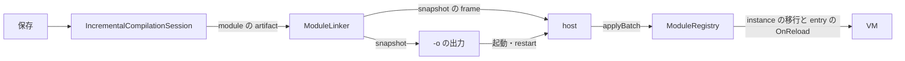

# hot reload の経路の統合 — native の watch と web を 1 つの session と registry にする

> Status: 設計中

native の watch (`--watch --reload-chunks`、1 本の出力と reload chunk) と、web の増分 session (`IncrementalCompilationSession`、module の snapshot と `ModuleRegistry`) を、1 つの経路にする。
compile 側は session、実行側は registry に揃え、reload chunk の経路は最後に消す。

## 1. 方針

- 判断の基準は「今の 1 回が速いか」ではなく「経路が 1 つになり、この先の高速化と機能がどちらの host にも効くか」。
- 実行側は registry に揃える。registry は transaction で失敗を巻き戻し、snapshot は起動にも live の適用にも同じものが使え (idempotent)、hash の同じ module は当てない。適用の手間が変わった module の数で決まるので、増分の compile と釣り合う。reload chunk は毎回全部の型を定義し直す。
- 意味は、今の 2 つの経路の強い方に揃える。watch だけが持つ instance の移行 (field の追加・削除・型の変更、struct の値の組み直し) は registry に移す。これを落とすと、今 live で当たる field の追加が restart になり、watch の利用者には後退になる。
- host (lub の native、`lub --serve`、web の player) は、どれも同じ snapshot を同じ手順で当てる。

## 2. 今の 2 つの経路の差

| 項目 | watch (reload chunk) | session と registry |
|---|---|---|
| compile | 保存のたびに全 file を変換 | 常駐の session。body だけの編集は method の差し替え |
| 当て方 | chunk を `_G` で実行。失敗したら VM を作り直す | `applyBatch`。失敗は巻き戻して前の版のまま |
| 型 table | `_G` の global | registry の `types`。module は read-only の env で定義し、`_G` には無い |
| instance | `__tcs_instances` を辿って移行 | 移行しない。instance の形が変わると restart |
| struct の layout の変更 | 値を組み直す | restart |
| `OnReload` | host が entry と overlay の static `OnReload()` を 1 回ずつ | registry が entry の static `OnReload()` を 1 回 |
| restart の判定 | `ReloadRules` (`migratesInstances: true`)、VM の動いている build と比べる | 同じ規則 (`migratesInstances: false`)、session の前の revision と比べる |
| `--trace` | あり | なし。trace の global の代入は env が拒む |
| 版の guard | `__tcs_build` の from → to の assert | revision の単調増加。古い版は黙って飛ばす |
| source map、`--prelude`、`--no-runtime`、`--module` | あり | なし |
| 複数の file の同時の保存 | 1 回の変換 | file ごとに `Update` (revision も file ごと) |

`doc/incremental-module-compilation-design.md` §16 の「native は static を再実行する」は今は当たらない (chunk も static を保つ)。今の差は上の表の instance、struct、`OnReload` を呼ぶ側、`--trace`。

## 3. 目標の形

- watch は session を常駐させ、debounce の間に保存された file をまとめて 1 つの revision にする。
- 成功した revision ごとに、snapshot を `-o` に書いてから frame で送る。host は frame の snapshot を当てる (mtime は見ない)。restart は `-o` の snapshot から VM を起こす。
- restart の判定は、VM が動いている revision (host が当てた最後の snapshot) と比べる。
- compile error は `build_failed`、restart は `restart_required` のまま。

## 4. 段階

各段は、その段だけで今の利用者を壊さずに入る。最後の段まで、reload chunk の経路は今のまま動く。

### 4.1 session の emit を watch と同じにする

- `EmitModule` と method の差し替えに、instance registry と `--trace` を渡す。registry の env は trace の global (`__tcs_trace`、`__tcs_trace_classes`) を host に通す。
- top-level 文、`--entry` の検査、`--module`、source map、`--prelude`、`--no-runtime` を、snapshot でも使えるようにするか、使えないときは watch が今と同じ error で止める。
- 受入: session と全体の変換の実行時の差分 test (同じ program を両方で動かして結果が一致)。今の `IncrementalDifferentialTests` は全体の変換を自分と比べているだけなので、ここで本物にする。

### 4.2 registry に instance の移行を入れる

- `applyBatch` の commit の後に、旧い形と新しい形 (field と型、initializer、struct の layout) から instance と struct の値を移す。規則は `HotReload` と同じで、`migratesInstances: true` に揃える。
- module の artifact に、移行に要る形 (field の型の列、足した field の initializer) を足す。`IlExport.ExportShape` と同じものを session の model から取る。
- 受入: reload fuzz の不変量 (retained の保持、added は initializer、dropped は nil、identity、method の差し替え、instance の `OnReload` は呼ばない) を registry の経路で通す。`ReloadRulesAlignmentTests` の意図した差は無くなる。

### 4.3 watch を session で動かす

- 保存された file の集合を 1 回の `Update` (複数 file) に渡し、1 つの revision にする。`--ref` が変わったら session を作り直す。
- frame に snapshot の kind を足し、`-o` を書いてから送る。restart の判定は VM の動いている revision と比べる。
- 速さ: body だけの編集は session の fast path、それ以外は session の slow path。slow path にも、`doc/watch-rebuild-design.md` §4.1 の model の共有を入れる。
- 受入: Watch* の test 一式を snapshot の frame で通す。linux-arm64 の実機で、body の編集と宣言の編集の保存 → 適用を測る。

### 4.4 host を snapshot に移す (lub)

- native: snapshot の frame を chunk と同じ時点 (frame の頭、`OnFrame` の前) で実行し、registry が当てる。失敗は前の版のまま `OnBuildFailed` と同じ形で知らせる (VM は作り直さない)。`__tcs_module_runtime` を見て、mtime の hotswap を止める。
- overlay の型は `lua_getglobal` ではなく registry から引く。Rewind の根は registry の `types` (overlay の型を除く)。`Sys.TakeTrace` と `Gfx.Pick` は 4.1 の trace のまま動く。
- `OnReload`: registry が entry の分を呼び、host は overlay の分だけを呼ぶ (二重に呼ばない)。
- `lub --serve` と web の player も、同じ snapshot を同じ入口で当てる。
- 受入: lub の C# サンプルと、lub を使う host の runtime test 一式が通る。

### 4.5 reload chunk の経路を消す

- `--reload-chunks` の chunk、`HotReload` の chunk の組み立て、`__tcs_build` の guard、host の chunk の入口を消す。C backend の `IlExport` は残す。
- 受入: watch と web の hot reload の test が registry の経路だけで通る。

## 5. 決めたこと

- 保存ごとに host へ送るのは、変わった module だけの batch にする。batch は当てる基準の revision を持ち、VM の revision と合わなければ host は当てずに `-o` から起動し直す。`-o` には毎回全部の snapshot を書く (起動と restart 用)。全部の snapshot を毎回送ると、Lua の load が project の大きさに比例し、変わった量で決まらない。基準の revision は、restart の判定を VM の版と比べること (4.3) と、今の `__tcs_build` の from → to の検査を兼ねる。registry は一部だけの batch を受ける形にする (今は snapshot に無い module を error にする)。
- 型 table は registry だけに置き、`_G` には書かない。module が自分の key を持つので、消した型や member を確実に消せ、誤った global への書き込みを error にできる。`_G` にも書くと、置き場所が 2 つになって消し忘れが残り、host の global (lub の `Gfx` など) と同じ名前の型が host の API を上書きする。host には registry から型を引く口を足し、lub の overlay と Rewind は 4.4 で直す。

- `OnReload` は、registry が entry の static の分を commit の後に 1 回呼び、host は overlay の分だけを呼ぶ。契約を tcs の runtime 1 か所で満たし、native と web で同じにする。instance method の `OnReload` は hook にしない (使う所が無い)。

## 6. 残課題

- module mode は top-level 文を module の define の中で走らせる。static の初期化より前に走り、その module を当て直すたびに走り直す (全体の変換は型と static の後に 1 回)。watch を session に移すとき (4.3) に、top-level 文のある project の扱いを決める。

- asset などの派生データが dirty かどうかの根拠に `OnReload` を使うのはよくない。今は lub のサンプル (19_sdf、22_tonton、23_crane_game、25_bowling) が dirty の flag を `OnReload` で立てている。代わりの形は未定。
